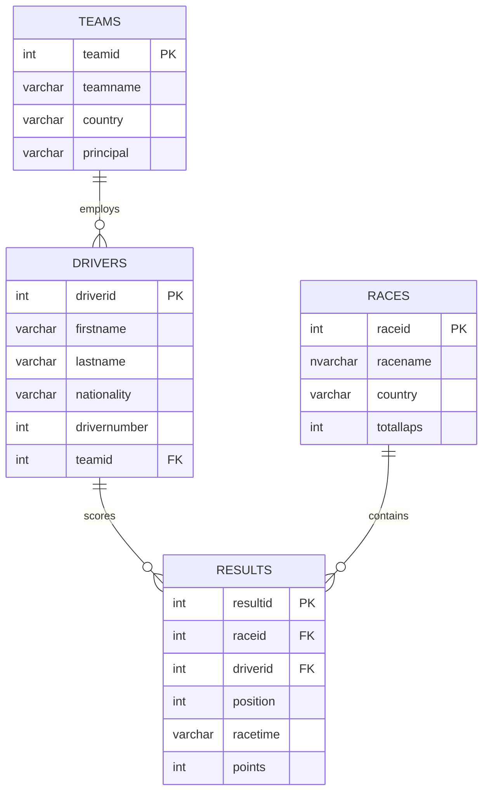
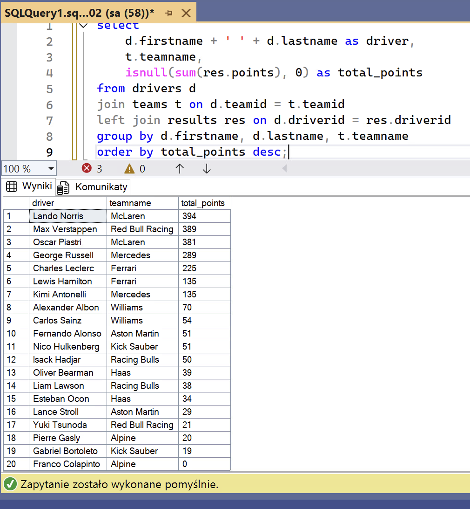
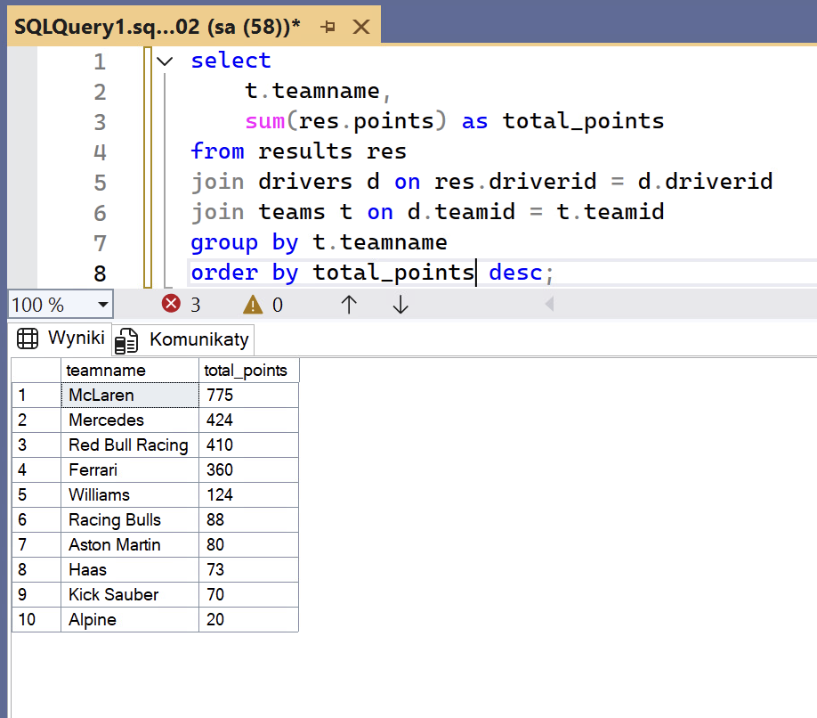

# 🏎️ Formula 1 — Season 2025 Database

A relational database of the **2025 Formula 1 season** built in **Microsoft SQL Server (T-SQL)**.
It stores teams, drivers, the full race calendar and the top-10 results of every Grand Prix, and calculates the drivers' and constructors' standings with SQL queries.

> University project — *Systemy baz danych*, WSB Merito Wrocław, Informatyka inżynierska.

## Tech stack
- Microsoft SQL Server
- SQL Server Management Studio (SSMS)
- T-SQL: `JOIN`, `LEFT JOIN`, `GROUP BY`, aggregate functions, `ISNULL`, `UNION ALL`

## Database schema



| Table | Rows | Description |
|---|---|---|
| `teams` | 10 | Teams with country and team principal |
| `drivers` | 20 | Two drivers per team, nationality and race number |
| `races` | 24 | Full 2025 calendar (Australia → Abu Dhabi) |
| `results` | 240 | Top 10 of each race; winner's total time, others' gap to the leader |

Points follow the standard F1 system: 25, 18, 15, 12, 10, 8, 6, 4, 2, 1.

## Project structure

```
├── sql/
│   ├── 01_create_tables.sql   # database + tables with primary/foreign keys
│   ├── 02_insert_data.sql     # all data (teams, drivers, races, results)
│   └── 03_queries.sql         # analytical queries
└── screenshots/               # query results from SSMS
```

## How to run
1. Open **SQL Server Management Studio** and connect to your server.
2. Run the scripts in order: `01_create_tables.sql` → `02_insert_data.sql` → `03_queries.sql`.

## Queries
1. Row count of every table (`UNION ALL`)
2. Results of a single Grand Prix with driver and team names (`JOIN` of 4 tables)
3. Drivers' standings — `LEFT JOIN` + `ISNULL`, so drivers without points (e.g. Franco Colapinto) are shown too
4. Constructors' standings — points summed per team

## Results

**Drivers' standings (top 5)**

| # | Driver | Team | Points |
|---|---|---|---|
| 1 | Lando Norris | McLaren | 394 |
| 2 | Max Verstappen | Red Bull Racing | 389 |
| 3 | Oscar Piastri | McLaren | 381 |
| 4 | George Russell | Mercedes | 289 |
| 5 | Charles Leclerc | Ferrari | 225 |

**Constructors' standings (top 5)**

| # | Team | Points |
|---|---|---|
| 1 | McLaren | 775 |
| 2 | Mercedes | 424 |
| 3 | Red Bull Racing | 410 |
| 4 | Ferrari | 360 |
| 5 | Williams | 124 |




> ℹ️ The totals differ slightly from the official 2025 standings, because the database stores only Grand Prix results — **sprint races are not included**.

## Author
**Ostap Avramkin** — Informatyka inżynierska student, WSB Merito Wrocław
